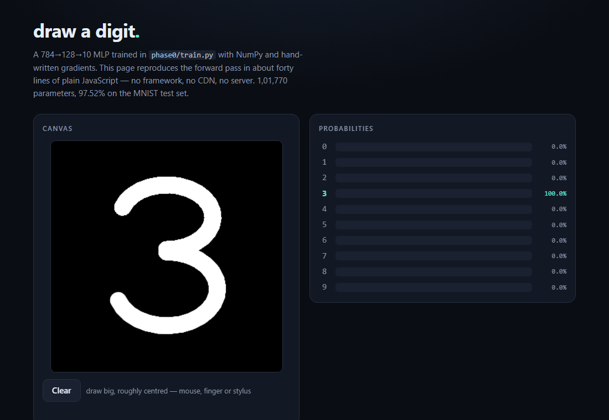
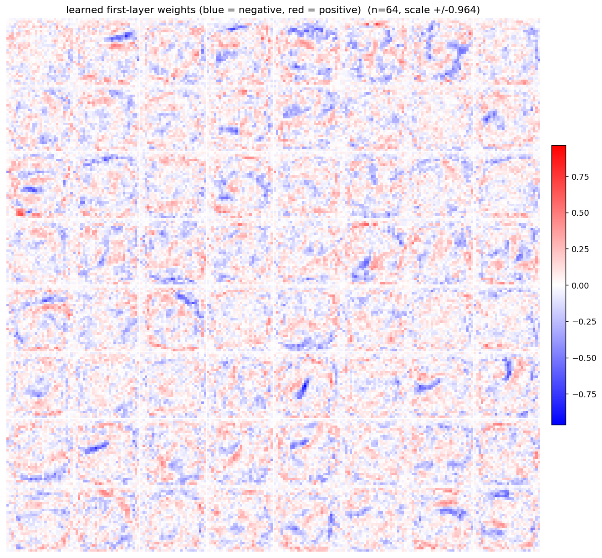
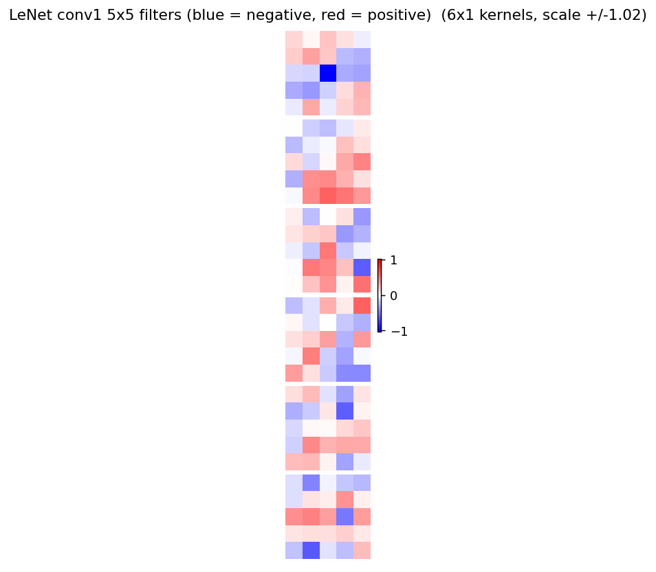
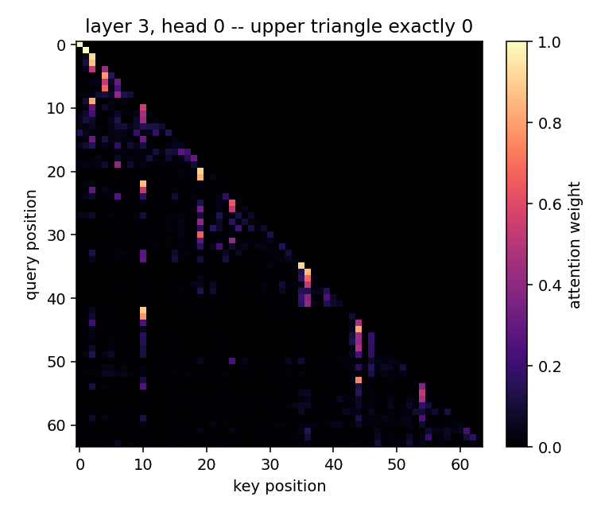
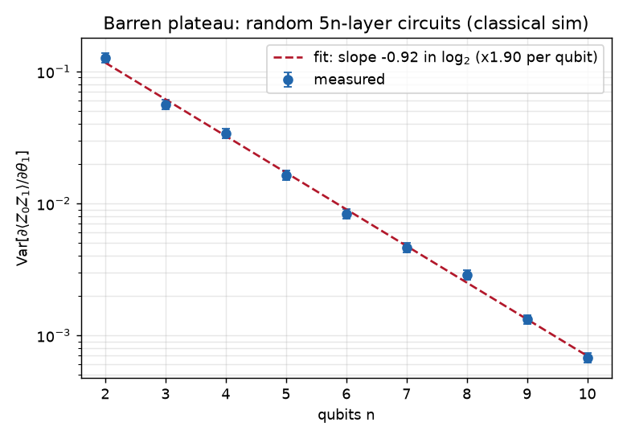
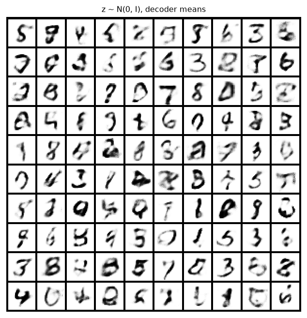

# scratchgrad

A deep-learning framework written from scratch in pure NumPy. **Every gradient in this repository is
hand-derived.** NumPy supplies array storage and BLAS matrix multiply; nothing else. No PyTorch, no
TensorFlow, no JAX, no autograd library — and that claim is enforced by a test that fails the build
if any file under `src/` ever imports one.

It goes from a scalar autograd engine up to a working Transformer: reverse-mode autodiff over
n-dimensional arrays, a module system, convolutions, LSTMs, multi-head attention, six optimizers,
and a mini-GPT — trained on CPU, with every gradient independently verified four different ways.

There is also a thing you can actually look at: **draw a digit in your browser and watch a network
you wrote name it.**



*The single-file demo (`phase0/mnist_demo.html`) in headless Edge, with a synthetic "3" stroke; the
probabilities are the real output of the NumPy-trained weights running in plain JavaScript.*

**Contents:** [Quickstart](#quickstart) · [What is in it](#what-is-in-it) ·
[Results](#results) · [Verified on 2026-09-26](#verified-on-2026-09-26) ·
[Benchmarks](#benchmarks) · [Tests](#how-this-is-verified) · [Layout](#repository-layout) ·
[Contributing](#contributing)

---

## The showpiece

```bash
python phase0/train.py        # ~1 minute on CPU
python phase0/export_web.py
start phase0/web/index.html   # (macOS: open, Linux: xdg-open)
```

A canvas, a network, and ten live probability bars. It runs from a double-clicked `file://` page with
nothing installed — no server, no build step, no CDN.

`phase0/` is deliberately **self-contained**: seven flat files, about 200 lines of NumPy for the whole
"framework", and it imports nothing from `scratchgrad`. That is the point. You can read the entire
thing in one sitting and satisfy yourself that no library is doing the work. (A test enforces the
isolation, too.)

The hard part of that demo is not the matrix multiplies. It is that MNIST digits were size-normalised
to a 20×20 box and centred **by centre of mass** in a 28×28 field, and a model that skips that
preprocessing reads hand-drawn input as noise. Measured, on 300 test digits pushed through the real
browser pipeline in headless Chromium:

| | accuracy |
|---|---:|
| with `mnistify` | **98.0%** |
| without it | **20.3%** |

The same weights, the same forward pass. That is a 98%-accurate network looking completely broken
because of twenty lines of preprocessing, and it is why the demo shows you the 28×28 tensor it is
actually feeding the net. Driving the page with synthetic strokes classifies **5 of 5** digits
correctly; the single-file build makes **zero** external network requests.

---

## The receipt

A loss that goes down is not evidence a gradient is correct. A transposed axis, a missing broadcast
reduction, or a misplaced `1/N` all still descend — just to a worse place. So:

```bash
python phase0/gradcheck.py
```

Correctness here is established four independent ways, because each one alone has a blind spot:

| Check | What it proves | Blind spot it covers |
|---|---|---|
| **Finite differences** vs every hand-written VJP, float64, random cotangent | `backward == d(forward)/dx` | catches sign, scale and reduction errors |
| **Adjoint identity** `⟨v, Au⟩ = ⟨Aᵀv, u⟩`, exact to 1e-13 | linear ops are exactly right, with no step size at all | finite differences bottom out near 1e-9; this does not |
| **Forward-value tests** against hand-computed constants | the *forward* is right | a wrong forward with a self-consistent backward passes gradcheck at 1e-15 forever |
| **PyTorch oracle** (`tests/oracle/`, torch used *only* here) | independent agreement to 1e-11 | catches convention mistakes both of my own implementations would share |

Measured worst-case relative error across the core operations: **5.5e-10** (tolerance 1e-9 per op,
1e-7 for a composed loss). The adjoint test lands at **2.1e-16**.

Two details that decide whether gradient checking works at all, both learned the hard way here:

- **float64 or nothing.** In float32 a *correct* gradient shows ~1e-2 relative error, so the check
  has no power and silently passes everything. `gradcheck` refuses to run in float32.
- **Normalise by the array scale, not per element.** Central differences have a noise floor set by
  the magnitude of the *objective*, not of the individual gradient entry. A legitimately small entry
  can therefore never pass a per-element 1e-9 test no matter how correct it is. This was found the
  hard way: the very first `matmul + bias` check "failed" at 1.63e-8 with a perfectly correct
  gradient. Details in [`notes/derivations/09-gradient-checking.md`](notes/derivations/).

---

## Quickstart

**Prerequisites:** Python 3.10+ and [uv](https://docs.astral.sh/uv/) (or plain `pip`). The only
runtime dependency is NumPy; matplotlib is optional (plots), and PyTorch is needed only for the
oracle tests and the benchmark comparison. Datasets download on first use into `data/`.

```bash
git clone https://github.com/ChPuru/scratchgrad.git && cd scratchgrad

uv sync                   # numpy + dev tools (pytest, ruff, matplotlib)
uv sync --all-groups      # ...plus PyTorch, for tests/oracle and the benchmark
# or, without uv:  python -m venv .venv && pip install -e ".[plots]" pytest pytest-xdist

uv run pytest tests -q -m "not slow and not network"   # the fast suite, as CI runs it
uv run python phase0/gradcheck.py                      # every Phase 0 gradient vs finite differences
uv run python examples/mnist_mlp.py --epochs 5 --seed 0  # train an MNIST MLP (downloads MNIST)
```

The examples and benchmarks also run from a plain checkout with `PYTHONPATH=src python ...`, which is
how the commands further down are written.

```python
import numpy as np, scratchgrad as sg
from scratchgrad import nn, optim
from scratchgrad.data import DataLoader, mnist

train, test = mnist()                       # downloads + hand-parses the IDX format
model = nn.Sequential(nn.Linear(784, 128), nn.ReLU(), nn.Linear(128, 10))
opt = optim.Adam(model.parameters(), lr=1e-3)

for xb, yb in DataLoader(train, batch_size=128, shuffle=True, rng=np.random.default_rng(0)):
    loss = nn.functional.cross_entropy(model(sg.Tensor(xb)), yb)   # raw logits in
    opt.zero_grad(); loss.backward(); opt.step()
```

Defining something the library has never seen works the same way — a new primitive needs a forward
and its VJP, and nothing else:

```python
from scratchgrad.tensor import Tensor

def softsign(x):                                   # x / (1 + |x|)
    d = 1.0 + np.abs(x.data)
    return Tensor._make(x.data / d, (x,), (lambda g: g / (d * d),), "softsign")
```

`tests/test_extensibility.py` builds a custom primitive, a maxout layer, a branching model with
shared weights, a focal loss, a sign-SGD optimizer and a novel gated-residual architecture — all
against the public API only — and gradchecks every one. There is a test asserting none of those names
appear anywhere in `src/`, so the claim cannot become circular.

---

## What is in it

| Tier | Contents |
|---|---|
| **Autograd** | `Tensor` with reverse-mode autodiff over `np.ndarray`; broadcasting handled by `unbroadcast`; **iterative** topological sort (a recursive one dies at CPython's 1000-frame limit on any real unrolled RNN); gradient accumulation; `no_grad`; ~60 differentiable ops |
| **Library shape** | `Module` with `__setattr__` auto-registration, `Parameter`, `Sequential`/`ModuleList`/`ModuleDict`, buffers, `state_dict`, `train()`/`eval()`; Xavier / He / orthogonal init |
| **Layers** | `Linear`, `Conv1d`, `Conv2d` (stride, padding, dilation, groups), `MaxPool2d`, `AvgPool2d`, `AdaptiveAvgPool2d`, `BatchNorm1d/2d`, `LayerNorm`, `GroupNorm`, `RMSNorm`, `Dropout`, `Embedding` |
| **Sequences** | `RNNCell`, `LSTMCell`, `GRUCell` and multi-layer `RNN`/`LSTM`/`GRU`, truncated BPTT, gradient clipping |
| **Parallel-scan RNNs** | `linear_scan` (`h_t = a_t·h_{t−1} + b_t` in one vectorised pass, backward = reverse scan), `MinGRU`, Mamba-style `SelectiveSSM` / `selective_scan` |
| **Quantization** (`scratchgrad.quant`) | affine quant per-tensor/per-channel, `fake_quant` with a clipped straight-through estimator, `QATLinear`, binary weights, integer-only int8 inference (`IntegerMLP`, fixed-point requantisation) |
| **Quantum** (`scratchgrad.quantum`) | complex statevector simulator, rotation/Clifford gates, a `Circuit` whose `expval` is an autograd op differentiated by the exact parameter-shift rule |
| **Generative** | `VAE`, `reparameterize`, closed-form `gaussian_kl`, `negative_elbo` |
| **Attention** | scaled dot-product attention, causal masking, `MultiHeadAttention`, pre-LN `TransformerBlock`, a full `GPT` with sampling |
| **Optimizers** | SGD (momentum/Nesterov), Adagrad, RMSProp, Adam, AdamW, Adadelta; `clip_grad_norm_`; step/multi-step/exponential/cosine/warmup schedulers |
| **Data** | hand-written IDX parser (MNIST, Fashion-MNIST), CIFAR-10, char-level text; `Dataset`/`DataLoader` with seeded shuffling |
| **Tooling** | checkpointing, seeding, meters, plotting; a benchmark harness against PyTorch CPU |

---

## Results

Every number below is produced by a command in this repo, from a fixed seed, on CPU.

### MNIST, 784 → 128 → 10 MLP (101,770 parameters)

`python examples/mnist_mlp.py --epochs 5 --seed 0` — **5.0 s**, **97.50%** test accuracy.

| epochs | train loss | test loss | test accuracy |
|---:|---:|---:|---:|
| 5 | 0.0704 | 0.0808 | **97.50%** |
| 20 | 0.0060 | 0.0850 | 97.65% (peak 97.87% at epoch 15) |

Five seconds is the idle-machine figure. The same command timed 45 s earlier in this project's own
history, while nine models were training concurrently on the same box — a reminder that a wall-clock
number without a statement about machine load is not a measurement. The *accuracy* is unaffected and
bit-identical across both runs, which is what `tests/test_reproducibility.py` exists to guarantee.

The 5-epoch row is the headline because it is the configuration fixed *before* looking at any test
number. The 20-epoch run is shown because it is informative rather than flattering: test accuracy
peaks around epoch 15 and then **declines** while train accuracy climbs to 99.87%. That is
overfitting, plainly. Quoting the epoch-15 peak as the result would mean selecting on the test set,
which this project lists as an anti-goal, so it is reported as an observation and not as the score.

This is also where a plain MLP tops out. Getting past ~98% needs convolutions.

The learned first-layer weights are worth a look — they come out as visible stroke detectors, arcs
and diagonals, not noise:



Rendered on a diverging blue–white–red scale, symmetric and **global** across all units. That detail
matters more than it sounds: grayscale gives −0.5 and +0.5 different greys with no cue which is
negative, and per-tile normalisation stretches a dead all-zero unit into pure noise that looks
exactly like a healthy learned feature.

### The equivalence proof

`phase0/` trains the *same* architecture with a completely separate implementation — hand-written
`backward()` methods on each layer, no autograd, no shared code. Same seed, same batch order. If both
are correct they should agree; the interesting question is how closely.

| epoch | Phase 0 train loss | framework train loss | difference |
|---:|---:|---:|---:|
| 1 | 0.349340968549191 | 0.349340998486678 | 3.0e-08 |
| 2 | 0.155055584049758 | 0.155070615041256 | 1.5e-05 |
| 5 | 0.070424733612513 | 0.070384112954140 | 4.1e-05 |

Final test accuracy 97.52% vs 97.50% — twenty-two digits out of ten thousand. The first epoch agrees
to **eight significant figures**; the drift afterwards is float32 accumulating in a different order
(one implementation fuses, the other composes graph nodes) and Adam amplifying that over 2,345 steps.
Neither drifts *systematically*.

This is the strongest correctness statement in the project, and it is stronger than a green test
suite: it shows a general autodiff engine reproducing a special case that had already been verified
by hand, independently, down to machine precision.

Timed back to back on an idle machine, Phase 0 takes **8.0 s** and the framework **4.9 s** for the
same five epochs. The general autograd engine is the *faster* of the two, which is not the result you
would predict: its `Linear` does one fused matmul per direction, while Phase 0's per-layer code is
written to be read rather than to be quick.

Worth stating because the first version of this paragraph claimed the opposite, at 3× in Phase 0's
favour. Those two figures had been measured at different times under different machine loads, which
makes them not a comparison at all. Re-measured back to back, the sign flips.

### MNIST, LeNet-5 (61,706 parameters)

`python examples/lenet_mnist.py` — 10 epochs, Adam with cosine decay, **613 s**, **99.03%** test
accuracy (9,903/10,000, independently re-evaluated from the saved checkpoint).

Convolutions buy 1.5 points over the MLP's 97.50% — the expected gap, and the reason a plain MLP
stops where it does.

**One caveat on how that number was arrived at**, because the project lists "accuracy measured on
tuned-on data" as an anti-goal and this run brushed against it. The first configuration was plain
Adam with no schedule; its **test** accuracy (98.66%) was observed *before* the decision to add a
cosine schedule was made. The comparison itself was then done properly — a 5,000-image validation
split held out of training, flat versus cosine, test untouched — and the winner retrained on all
60,000 and scored against test once. But the decision to look for a schedule at all was prompted by a
test number, and that is a real if mild contamination. It is named here rather than smoothed over.

Two details worth keeping from that comparison. Cosine's *validation* accuracy was slightly **lower**
than flat (98.96% vs 99.04%); it was chosen for endpoint stability — the last three epochs spread
0.02 points against flat's 0.32 — so that the reported figure is a measurement rather than a draw
from a lottery. And 99.03% clears the ≥99.0% target but does **not** reach the original 99.2% stretch goal;
LeNet-5 without augmentation lands in the 98.8–99.2% band, and no augmentation was added to chase the
headline.



### CIFAR-10, a small VGG (307,946 parameters)

`python examples/cifar10_cnn.py --epochs 8` — six 3×3 convolutions in three BN+ReLU pairs, max-pooled
between stages, dropout before a single linear head. Random crop from a reflect-padded 40×40 plus a
horizontal flip, both written by hand in NumPy.

| | |
|---|---|
| test accuracy | **82.81%** (8,281/10,000) |
| validation | 83.38% |
| train | 85.68% |
| wall clock | 6,171 s (**12.9 min/epoch**) |

Every decision — epochs, learning rate, dropout — was made against the last 5,000 training images,
held out as a validation split. The **test set was touched once.** Train-to-test gap is under three
points, so this is a model that could still be trained longer, not one that has run out of road.

Thirteen minutes an epoch is the honest cost of a convnet in pure NumPy, and it is the clearest
single argument for everything in `benchmarks/`. (A quick `--time-steps 15` probe predicted 10.8;
the full run measured 12.9. Short probes miss the per-epoch evaluation and the shuffle, so the
quoted figure is the one the run actually took.)

**A useful accident.** Re-evaluating this checkpoint as an independent check, I fed it plain `x/255`
and got **33.60%**. The model was fine; I had skipped the per-channel standardisation training used.
Same weights, same forward pass, 49 points of accuracy, and the per-class signature made it look like
a broken *model* — automobile fell from 94% to 2%, truck from 89% to 1%, while ship stayed at 89%.
That is the "train/inference preprocessing mismatch" row of
[`notes/verified-reference.md`](notes/verified-reference.md) happening live, and it is the second
instance in this repository: the browser demo's `mnistify` ablation is the same failure, 98.0% down
to 20.3%. Both times the model was innocent. This is why the mean and std are stored in the run's
`history.json` rather than left implicit in a training script.

### tiny-shakespeare, char-LSTM (944,577 parameters)

`python examples/char_lstm.py` — `Embedding(65,128) → LSTM(128, 256, 2 layers) → Linear(256, 65)`,
truncated BPTT at block 128, gradient clipping, 28 min.

Everything below is **per-token mean cross-entropy** on the same 10% held-out tail. Naming the
reduction is not pedantry: summed over T it would be `T·ln V` instead of `ln V`, and a gradient-clip
threshold quoted without it means nothing.

| model | nats | bits/char |
|---|---:|---:|
| uniform over V=65 (zero information) | 4.174 | 6.022 |
| trigram, add-α smoothed with backoff | 2.045 | 2.950 |
| **char-LSTM** | **1.695** | **2.445** |

Loss at initialisation came out at 4.174387269895638 against `ln(65) = 4.174387269895637` — a
one-ULP agreement, which is the cheapest possible confirmation that the model starts out knowing
exactly nothing and that the loss is measuring what it claims to.

The trigram baseline is the point of the comparison. "Beats random" is not an achievement; beating a
properly smoothed count-based model on the same split, by 0.35 nats, is.

The 1.695 figure is the deterministic full-coverage number (1,742 non-overlapping 64-token windows
over the whole split). The training loop's own sampled estimate said 1.630. Both language models in
this repository showed the same bias in the same direction — the GPT's sampled 1.687 became 1.723 —
which is what a few-thousand-token sample does. The reproducible number is the one quoted.

```
BUCKINGHAM:
Why arms barrs and countastion think is cold blissent:
Lew in the ising in bear out to't and my pretter the should grave queemes so taking,
```

### tiny-shakespeare, mini-GPT (809,856 parameters)

`python examples/mini_gpt.py` — `n_layer=4, n_head=4, n_embd=128, block_size=64`, 2000 iterations,
AdamW with cosine warmup.

| | |
|---|---|
| validation loss | **1.723 nats** = 2.486 bits/char (target was ≈1.88) |
| train loss | 1.565 nats |
| random-init reference | 4.174 nats on V=65 |
| wall clock | **780 s** (13 min), 390 ms/iteration |

The validation figure is a **deterministic full-coverage** pass: consecutive non-overlapping
64-token windows across the entire 111,540-character split, 1,742 windows, 111,488 tokens, no
sampling. It is exactly reproducible. A random-window estimate over 720 windows came out at 1.687,
about 2% optimistic — small, but it is the difference between a number anyone can regenerate and a
number that depends on which windows you happened to draw, so the reproducible one is what gets
quoted.

The budget deserves a note. 13 minutes is longer than the 2–5 minutes this configuration was
estimated at, and the estimate is the thing that was wrong, not the run. It is still the *only*
feasible scale here: nanoGPT's headline `6×384, T=256, 5000 iters` config is roughly 5.8 PFLOP,
which is **16–32 hours** in NumPy — that published number is an A100-in-PyTorch result and does not
transfer.

Attention from a trained model, layer 3 head 0 — strictly lower-triangular, with a clear recency
band and learned vertical stripes where the model has decided particular positions are worth
attending to:



A sample at temperature 0.8:

```
COMINIUS:
The you ere is live, dear his strume made.

KING RICHARD III:
It your heart sigh'ds this rame been or not at the
are well.
```

Not Shakespeare. But it has learned the speaker-name convention, the blank-line structure, plausible
English orthography and apostrophes — from characters alone, in 13 minutes, on a CPU, through an
autodiff engine written for this repository.

### Does attention actually beat the LSTM?

`ROADMAP.md` states the Tier-5 proof as *"beats the Tier-4 LSTM on identical data and budget"*. That
is a falsifiable claim, so it got tested rather than asserted — and the first answer was **no**.

At its default 2,000 iterations the GPT took 780 s against the LSTM's 1,676 s and **lost**: 1.723
against 1.695 nats. Half the compute, slightly worse. Reporting that as a Tier-5 success would have
meant quietly dropping the "and budget" half of the project's own claim.

So the GPT was rerun at 4,300 iterations to match the wall clock, and re-scored under the identical
deterministic protocol:

| model | nats | bits/char | wall clock | parameters |
|---|---:|---:|---:|---:|
| uniform over V=65 | 4.174 | 6.022 | — | — |
| trigram (add-α + backoff) | 2.045 | 2.950 | 0.06 s | — |
| char-LSTM (Tier 4) | 1.695 | 2.445 | 1,676 s | 944,577 |
| **mini-GPT (Tier 5)** | **1.588** | **2.291** | 1,784 s | 809,856 |

**Confirmed, at matched budget**: 0.107 nats (0.154 bits/char) better, with 14% *fewer* parameters.
The qualifier matters more than the result — at half the budget the same architecture loses, and a
comparison that did not control for it would have "proved" whichever conclusion it was pointed at.

---

### Tiers 8–11: beyond the LSTM, quantized, quantum, generative

Each tier ships with a derivation in `notes/derivations/10–13`, a verifier, and gradchecks. Every
number below is from a fixed seed and one command.

**Parallel-scan RNNs** (`examples/char_mingru.py`). minGRU's gates see only the input, so the
whole recurrence trains as one scan instead of `T` dependent steps. The scan matches a Python loop
to ~1e-16 at T = 4,096. Val loss is measured with the LSTM's in-training pass (1.630 for the LSTM;
the windowed 1.695 above is a different protocol and was not run for these):

| model | parameters | val nats | step time vs LSTM, measured side by side |
|---|---|---|---|
| char-LSTM (Tier 4) | 944,577 | 1.6303 | 1× |
| **minGRU** | 824,897 | **1.6282** | **6.9× faster** |
| selective SSM (tiny) | 320,833 | 1.8257 | 3.4× faster |

minGRU ties the LSTM (one seed, inside noise), and each training step runs 6.9× faster. The tiny
SSM loses by 0.2 nats. Traps measured: the closed-form cumprod scan returns NaN from step 118 in
float32, and the backward must carry the gradient through the *next* step's coefficient (using the
current one gives a 56% error).

**Quantized MNIST MLP** (`examples/quantize_mnist.py`). Every accuracy is from integer-only
inference: int8 × int8 → int32 accumulate → fixed-point requantise.

| | PTQ | QAT | bytes |
|---|---|---|---|
| fp32 | 97.56% | — | 407,080 |
| W8A8 | 97.54% | 97.76% | 103,426 |
| W4A4 | 97.10% | 97.56% | 52,610 |
| W2A2 | 21.96% | **91.59%** | 27,202 |
| W1A8 (binary weights) | 85.61% | 96.06% | 14,498 |

The textbook int32 bias (on the `s_x·s_w` grid) is off by up to M/2 output codes. At W2A2 the
integer and float models agreed on only 78% of predictions until the bias moved after the multiply.

**Quantum classifier** (`examples/quantum_classifier.py`). This is a classical simulation, so there
is no quantum-advantage claim. A 2-qubit data re-uploading circuit with 16 parameters, trained with
Adam through the parameter-shift op, reaches **98.5%** test accuracy on two moons. Parameter-shift
gradients match central differences to 1.9e-10. Barren plateaus reproduce McClean et al.: gradient
variance shrinks ×1.90 per added qubit, against ≈×2 predicted.



**VAE on MNIST** (`examples/vae_mnist.py`). The test negative ELBO is **101.14 nats/image**
(reconstruction 73.83 + KL 27.31), with all 20 latent units active. Averaging the reconstruction
over pixels, instead of summing it, makes the KL term 784× heavier. Measured, every latent unit
collapses and every reconstruction becomes the same grey blob. That is the most common VAE bug and
it trains without error.



## Verified on 2026-09-26

A fresh re-run of the fast checks on a **Windows 11 laptop** (Intel64 Family 6 Model 183, Python
3.12.11, NumPy 2.5.3, NumPy pinned to one BLAS thread by the benchmark). PyTorch was *not* installed
for this run, so the oracle tests skipped and the benchmark's torch columns are blank. The machine
was shared with other heavy jobs, so wall-clock times are upper bounds. Full terminal output is
checked in under [`assets/`](assets/).

| command | result | output |
|---|---|---|
| `pytest tests -q -m "not slow and not network" -n 4` | **884 passed, 2 skipped** (the two `tests/oracle` modules, no torch), 0 failed | [test_output.txt](assets/test_output.txt) |
| `ruff check src tests phase0 examples benchmarks` · `ruff format --check src tests` | all checks passed · 54 files already formatted | — |
| `python phase0/gradcheck.py` | **ALL CHECKS PASSED**; worst per-op rel. error 1.99e-10, adjoint 6.96e-17 | [gradcheck_output.txt](assets/gradcheck_output.txt) |
| `python notes/derivations/verify/run_all.py` | **150/150** checks across 13 derivations | [derivations_output.txt](assets/derivations_output.txt) |
| `python examples/mnist_mlp.py --epochs 5 --seed 0 --no-plots` | **97.58%** test accuracy (9,758/10,000), trained in 8.2 s | [mnist_mlp_output.txt](assets/mnist_mlp_output.txt) |
| `python benchmarks/bench_vs_torch.py --quick --repeat 5` | see below | [benchmark_quick_output.txt](assets/benchmark_quick_output.txt) |

Quick-mode benchmark, scratchgrad side only (median / min of 5 runs, ms):

| benchmark | median | min |
|---|---:|---:|
| matmul 256×256 f32 | 0.29 | 0.28 |
| matmul 1024×1024 f32 | 20.52 | 18.96 |
| MLP 784-128-10 forward | 0.26 | 0.25 |
| MLP fwd+bwd+Adam step | 1.66 | 1.58 |

The MNIST per-epoch train losses match the run quoted in [Results](#results) to four decimals
(0.3493 → 0.0704), but the final test accuracy came out at 97.58% rather than 97.50%. The two
runs used different NumPy/BLAS builds; bit-identical results are guaranteed within one environment
(`tests/test_reproducibility.py`), not across BLAS versions.

## Benchmarks

`python benchmarks/bench_vs_torch.py --repeat 7` — median of timed runs after warmups, **both sides
pinned to one thread**, identical shapes and dtype. The slowest rows (LSTM, mini-GPT) use fewer
repeats than the cheap ones, so the sample count is not uniform across the table.

| benchmark | scratchgrad | PyTorch CPU | ratio |
|---|---:|---:|---:|
| matmul 256² f32 *(floor: same BLAS)* | 0.51 ms | 0.49 ms | 1.04× |
| matmul 1024² f32 *(floor)* | 42.69 ms | 37.72 ms | 1.13× |
| MLP 784-128-10 forward | 1.18 ms | 0.51 ms | 2.32× |
| MLP fwd+bwd+Adam | 2.43 ms | 3.30 ms | 0.73× |
| LeNet-5 forward | 52.49 ms | 15.06 ms | 3.49× |
| LeNet-5 fwd+bwd+Adam | 125.18 ms | 37.65 ms | 3.32× |
| LSTM T=64 forward | 38.30 ms | 14.61 ms | 2.62× |
| LSTM T=64 fwd+bwd | 112.84 ms | 46.16 ms | 2.44× |

**About 2.5× slower than single-threaded PyTorch CPU** — the median over the six model rows in the
checked-in `benchmarks/results.json`, which spans 0.73× to 3.49×. The matmul rows are the floor:
both sides call the same BLAS, so ~1.1× is what "no overhead of our own" looks like. (`results.json`
holds one run and is overwritten by the next, so only the numbers above are backed by an artifact;
repeat runs on this machine landed between 2.3× and 2.5×, which is prose, not evidence.)

Two rows need honesty rather than a victory lap. The MLP training row reads **0.73×** — nominally
*faster* than PyTorch — and that is not a real win: across three runs the same row read 0.92×, 1.73×
and 0.73×, because at 2 ms the measurement is inside the noise and torch's Adam is taking a Python
path that a 100k-parameter model does not amortise. And the noise floor here is large: 30 runs of one
bit-identical 512² matmul gave median/min = 1.20× and max/min = 2.27×, so on this machine **any
single-row ratio within roughly ±30% is not an effect.**

Thread pinning is the part that is easy to get wrong, and this benchmark got it wrong first. NumPy's
OpenBLAS reads `OPENBLAS_NUM_THREADS` once, at library load, so it has to be set *before*
`import numpy`. Until it was, NumPy quietly used all 20 cores against torch's one and the matmul row
reported a **3.4× win** that was pure thread-count artifact. That number was never true and is not
in the table.

Three claims this project repeats elsewhere were re-measured here instead of taken on faith:

| claim | verdict | measured |
|---|---|---|
| float32 vs float64 matmul is ~1.5–2×, not 7.5× | **confirmed** | 2.15× |
| `np.einsum` without `optimize=True` never reaches BLAS (30–300×) | **confirmed** | 41× |
| skipping the input layer's `dX` is worth ~2.8× | **partly** | 2.19× on an MLP, but only 1.15× on LeNet — it is an MLP result and does not transfer to a convnet |

Why it is slower: no operator fusion, no threading, a Python-level graph node per operation, and an
im2col convolution that materialises the patch matrix. There is no GPU backend and none is claimed.
Full method and machine spec in [`benchmarks/README.md`](benchmarks/README.md).

---

## How this is verified

```
tests/
  test_tensor.py              the autograd engine: gradients, broadcasting, graph semantics
  test_nn_core.py             modules, initialization, dense layers, losses
  test_conv.py                convolutions at non-default stride/padding/dilation/groups
  test_norm.py                BatchNorm, LayerNorm, GroupNorm, RMSNorm, Dropout
  test_rnn.py                 cells, unrolled sequences, embedding scatter-add
  test_attention.py           attention, masking, the NaN trap, a full GPT
  test_optim.py               optimizers, schedulers, clipping, state round-trips
  test_data.py                the IDX parser against a synthetic buffer; loader pairing
  test_utils.py               checkpointing, seeding, meters, plots
  test_extensibility.py       the "General" property: build what the library never anticipated
  test_reproducibility.py     the "Reproducible" property: bit-identical, not approximately equal
  test_no_framework_imports.py   the "from scratch" claim, enforced
  test_phase0.py              the standalone showpiece
  oracle/                     agreement with PyTorch to 1e-11 (torch appears ONLY here)
```

`test_no_framework_imports.py` is the one worth calling out. "Built from scratch" is only true if it
is enforced: a silent `try: import torch` fallback in library code would make every gradient claim and
every benchmark in this README meaningless, and it would be invisible in review. So it is a test. It
walks the AST of every file under `src/` and `phase0/`, catches the dynamic dodge
(`importlib.import_module("torch")`), asserts `phase0/` does not import the package either, and
spawns a subprocess to confirm that importing `scratchgrad` does not pull in a framework even
transitively.

---

## Reproducing every number above

`ROADMAP.md` grades this project on reproducibility, and the test of that is whether a stranger can
regenerate the table rather than take it on trust. Every figure in this README comes from one of
these, at a fixed seed:

```bash
PYTHONPATH=src python -m pytest tests -q            # full suite, including slow + network tests
PYTHONPATH=src python -m pytest tests/oracle -q     # agreement with PyTorch to 1e-10

python phase0/gradcheck.py                          # the receipt
python phase0/train.py                              # 97.52%, bit-identical across runs
python phase0/export_web.py --inline                # the shareable single-file demo

PYTHONPATH=src python examples/mnist_mlp.py   --epochs 5   --seed 0
PYTHONPATH=src python examples/lenet_mnist.py --epochs 10  --seed 0
PYTHONPATH=src python examples/cifar10_cnn.py --seed 0
PYTHONPATH=src python examples/char_lstm.py   --iters 400  --seed 0
PYTHONPATH=src python examples/mini_gpt.py    --iters 2000 --seed 0
PYTHONPATH=src python examples/scalar_autograd.py   # the Tier-1a benchmark, and why it was discarded

PYTHONPATH=src python benchmarks/bench_vs_torch.py --repeat 7
PYTHONPATH=src python notes/derivations/verify/run_all.py   # 150/150 derivation checks
```

Each training script writes `runs/<name>/history.json` next to its checkpoint, so the numbers quoted
here can be diffed against a fresh run rather than re-read from prose. "Reproducible" is also
enforced as a test: `tests/test_reproducibility.py` asserts **bit-identical** losses and weights
across runs — not approximately equal, which a deterministic library would pass even with a drifting
shuffle — and perturbs the *global* NumPy RNG between runs to catch any layer that reached for it
instead of its own `rng=` argument.

---

## Honest capability statement

`scratchgrad` is a working reverse-mode autodiff framework in NumPy that can define and train MLPs,
CNNs, LSTMs, parallel-scan RNNs, a small Transformer, a VAE,
quantized integer-only networks and simulated quantum circuits on CPU, with every gradient independently verified.

It is **not** GPU-accelerated, distributed, fused, JIT-compiled, or competitive with any real
framework on speed. There is no CUDA kernel here and none is claimed. Saying this plainly is what
makes the rest of the document believable.

---

## Repository layout

```
src/scratchgrad/     the framework
  tensor.py            autograd engine
  nn/                  layers, losses, init
  optim/               optimizers and schedules
  data/                datasets and loaders
  testing/gradcheck.py the verification tools
  utils/               checkpointing, seeding, meters, plots
phase0/              the self-contained draw-a-digit showpiece (imports nothing from src/)
examples/            training runs that produce every number in this README
benchmarks/          honest comparison against PyTorch CPU
notes/
  verified-reference.md   traps that fail silently, and verdicts on the source material
  derivations/            every non-obvious backward pass, derived by hand and checked numerically
tests/               see above
assets/              plots, the demo screenshot, and captured terminal output
docs/API_CONTRACT.md the internal API conventions (tensor, module, layouts, tolerances)
ROADMAP.md           the grading rubric, the tiers, and what would make this fake
```

## Contributing

Issues and pull requests are welcome. The bar for a change is the same one the rest of the code
meets:

- **Every new op or layer ships with a gradcheck** in `tests/` (float64, prime-sized shapes), plus a
  forward-value test where a wrong forward could pass gradcheck.
- **Nothing under `src/` may import a deep-learning framework.** PyTorch belongs only in
  `tests/oracle/`, and those tests must skip cleanly without it.
- Follow the conventions in [`docs/API_CONTRACT.md`](docs/API_CONTRACT.md): weight layouts, raw
  logits, explicit `rng: np.random.Generator` arguments, tolerances.
- Before opening a PR, run what CI runs:

  ```bash
  uv sync --all-groups
  uv run ruff check src tests phase0 examples benchmarks
  uv run ruff format --check src tests
  uv run pytest tests -q -m "not slow and not network"
  uv run pytest tests/oracle -q -m "not network"
  ```

- A new result in this README needs the command that produced it and a fixed seed.

## Further reading

- [`ROADMAP.md`](ROADMAP.md) — the five properties this project is graded against, the anti-goals,
  and the tier-by-tier build order.
- [`notes/verified-reference.md`](notes/verified-reference.md) — a table of failures that produce
  plausible wrong behaviour instead of an exception, plus verdicts on sixteen widely-cited
  from-scratch tutorials. **Five of them contain real, verifiable bugs**; two more links are dead.
- [`notes/derivations/`](notes/derivations/) — softmax cross-entropy, LayerNorm, BatchNorm, conv,
  LSTM, attention, Adam and gradient checking, derived rather than restated, each verified
  numerically against the code.

## License

MIT — see [LICENSE](LICENSE).
